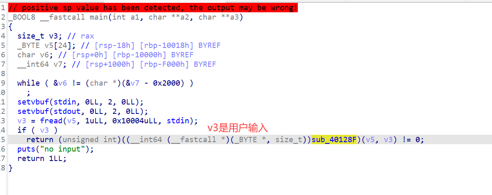

### 系统层漏洞利用与逆向分析-安全补丁对比分析-G4

#### 早期版本分析

通过对`main`函数的分析，可以定位到处理输入的函数地址为`0x40128F`



跟进去看一下，附带标注：

```c
__int64 __fastcall handle(unsigned __int16 *input, unsigned __int64 input_len)
{
  unsigned __int16 element1; // r12
  unsigned __int16 element2; // r14
  unsigned __int16 element_mux; // di
  void *buf; // r15
  void (**buf2)(void); // r13
  size_t cpy_len; // rdx

  if ( input_len <= 3 )
  {
    puts("too short");
    return 0xFFFFFFFFLL;
  }
  else
  {
    element1 = *input;                          // 第一个元素
    element2 = input[1];                        // 第二个元素
    element_mux = element2 * *input;            // 第一个和第二个元素相乘
    if ( !element_mux )
      element_mux = 1;
    buf = malloc(element_mux);
    if ( buf )
    {
      buf2 = (void (**)(void))malloc(0x40uLL);  // 感觉反编译有点问题，有函数指针的写法，但是从后面的功能上看，buf2确实被分配了内存
      if ( buf2 )
      {
        *buf2 = (void (*)(void))put_msg;        // buf2存的是puts函数指针
        cpy_len = element2 * (unsigned __int64)element1;// 很多关于长度的计算啊
        if ( input_len - 4 <= cpy_len )         // cpy_len是input_len-4,input是int16类型指针，这里撇掉了前两个元素
          cpy_len = input_len - 4;              // len都是按字节计
        memcpy(buf, input + 2, cpy_len);        // 说明input前两个元素有特定功能
        (*buf2)();                              // 函数指针调用——buf2是函数指针的指针，函数指针应该存在于被分配的内存中
        free(buf);
        free(buf2);
        return 0LL;
      }
      else
      {
        free(buf);
        puts("oom");
        return 0xFFFFFFFFLL;
      }
    }
    else
    {
      puts("oom");
      return 0xFFFFFFFFLL;
    }
  }
}
```

初步观察可以发现利用点就是`buf2`是函数指针的指针，现在关键是要如何动分配给`buf2`的那一块内存。

注意到`buf`和`buf2`是相邻的`malloc`的内存，我们可以尝试从`buf`溢出到`buf2`。——利用`malloc`内存和`memcpy`写入内存大小的不匹配（`memcpy`写更多）。

*那我们检查：`cpy_len`是否大于`element_mux`？*

从代码上看，他们的计算方式一样（`element1 * element2`），但是`cpy_len`有与`input_len`比较的修正，导致`cpy_len`不会大于`element_mux`。

但仔细看，`cpy_len`大小8字节（`rdx`），`element_mux`大小2字节（`int16`）。乘法做完后，`element_mux`只取了低16位。——这个**位宽错配**会让`cpy_len`更大。

**我们让两个元素的乘积为`0x10000`的倍数（可以就是`0x10000`），这样计算的`element_mux`为`0`（代码修正后`buf`大小为1字节），而`cpy_len`为`0x10000`，足够覆写过`buf`的1字节。**

这里修正一点：`malloc(1)`不会真的只给你1字节，它要**遵守堆分配器的机制**：

- **最小 chunk 大小是 0x20**（64 位下，含 0x10 的 chunk 头，0x20最小块）
  
  - `0x10`的头部中，头8字节是`prev_size`，后8字节是`size`，实际最小块可用是24字节，因为`prev_size`内容没作用，你可以溢出写到下一个chunk的`prev_size`中。

- **按16字节对齐**

**因此，`buf1`的可以空间是最小块空间（可写24个字节）；写24字节后，写到`buf2`的`size`部分，我们需要再覆写8字节（一共32字节），才能写到`buf2`的可用内容。**

**因此payload可以是：`0x100`+`0x100`+任意32字节+`0x4013A2`（8字节，get_flag函数地址）**

我们让AI帮我们落实这个思路，让它预留好靶机IP和PORT的填写区。
脚本位置`exp/exp.py`，填写好靶机信息后，直接`python exp.py`即可。

#### 总结与防御建议

总结是学到了关于`malloc`、内存分配器分配内存的知识。

关于防御建议，这题是`memcpy`和`malloc`内存大小不匹配造成的，本质上也是“**写入数据和缓冲区大小不匹配**”。

这里的代码层面，虽然不是用同一个变量控制内存大小，但是从逻辑上确实也避免了溢出风险。但还有一层，**位宽错配**。——建议统一为一个变量。

v2版本的防御，也是从这里下手——它统一成了一个变量，且对两个元素的乘法运算做了溢出检测
