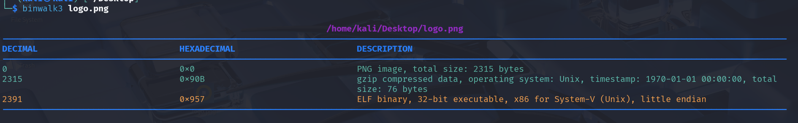
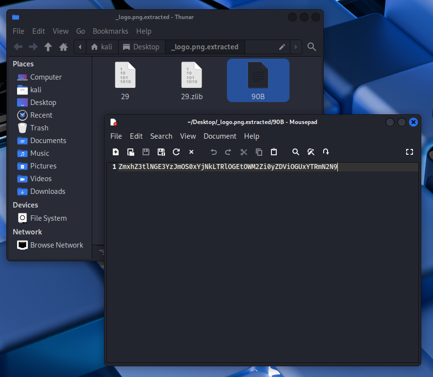

### 高级工具与逆向专项-Binwalk工具使用

#### 安装

既然是`binwalk`使用，那么就使用一下它！

`kali`官方仓库中有编译好的`3.10.0`版本，使用`kali`系统可以快速安装：

- `sudo apt update`

- `sudo apt install binwalk3`

- `binwalk3 -V `

有问题把报错信息丢给AI帮看一下就行了，核心就一句命令。

#### 调用

安装好后，使用`binwalk3`命令调用。

对于此题，键入执行`binwalk3 logo.png`：

可以发现除了一开始的`PNG`信息外，还包含了`gzip`压缩数据（偏移`0x90B`），以及一个ELF可执行文件（偏移`0x957`）。

把额外的数据拼接在PNG文件末尾是很常见的隐藏手段，因为读取PNG文件时，只会读取到IEND标记（PNG图片分块，IEND是最后一个块）就停止，所以直接打开图片是正常的。

接着键入执行`binwalk -e logo.png`自动提取内容，执行后在同目录下出现了一个名为`_logo.png.extracted`的文件夹。

`90B`名称的文件，是提取出的`gzip`压缩数据内容。
直接用文本打开，或`cat`命令访问，发现是一串字符串，这可能是某种编码！

这是`Base64`编码，拿去网上的小工具解码后，即可获取`flag`。
