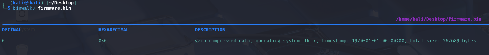
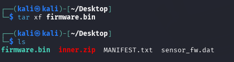
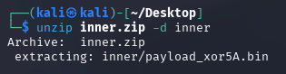
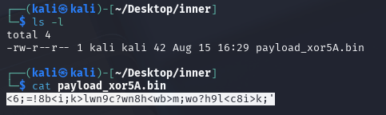

### 高级工具与逆向专项-Binwalk工具使用-G2

#### 题目提示——多次封装

第一次`binwalk3 firmware.bin`得到如下结果：

`gzip`说明这是一个压缩包！
使用`tar xf firmware.bin`解压，发现多了三个文件：

 关注到`inner.zip`，经过`binwalk3 inner.zip`验证，确是一个压缩文件。
 使用`unzip inner.zip -d inner`，得到如下结果：

检查该文件，发现它主要信息为文本：

根据这个名字，它应该是`flag`与`0x5A`按位异或的结果，把这串再和`0x5A`再次异或一下。

然后得到的是类似与G1类似的一串字符串，拿去`base64`解码即可出`flag`！

*`flag`不直接透露。*
