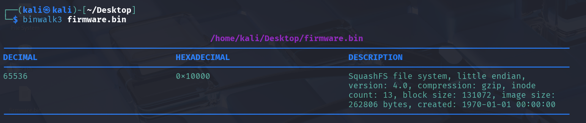

### 高级工具与逆向专项-Binwalk工具使用-G3

使用`binwalk`工具检查，得到如下结果：

能被识别的数据从`0x10000`开始，那么前面的都是些什么呢？

我用了`HxD`查看，结果——前面的数据几乎全空！那我们还是专注于`0x10000`后的数据！

看不懂这段描述——我丢给了AI，AI说：
这是一个 **SquashFS 文件系统镜像**——只读的、压缩的Linux文件系统，嵌入式设备（路由器、摄像头、IoT）最常用它装rootfs。

AI额外指出 ，这不应该是一个完整的固件`rootfs`，因为`inode count`是13，这太少。而且从文件大小上看，它也不可能是完整的。

回到正题，现在我们试着使用`binwalk3 -e`来提取它！

提取获得了一个目录，在`./extractions/firmware.bin.extracted/10000/squashfs-root/etc/config/`中，可以看到一个`flag.conf`的文件。

点开来看得到：
`CONFIG_FLAG=synt{3q9o6s2p-8n1r-4q7o-ns9p-1r4n7q2o6p8s}`

`synt`似乎不是flag的格式，但是看起来`{`、`-`等字符没有被编码，因此这应该是一种针对字母的编码方式——我想到了`ROT13`。

拿去进行`ROT13`解码，果真如此！

*`flag`不直接呈现。*

