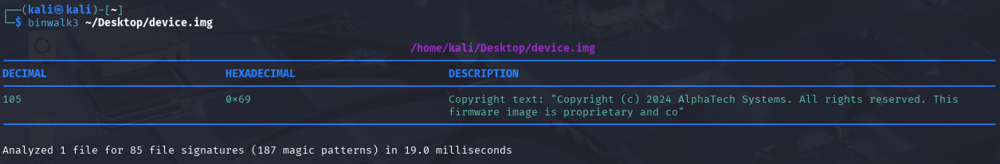
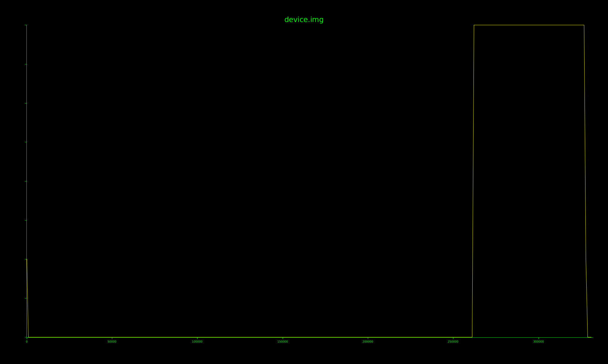

### 高级工具与逆向专项-Binwalk工具使用-G4

使用`binwalk`工具分析：



看来这是一个映像文件。

直接使用`binwalk3 -e`提取！

得到的`extractions`目录下只有一个链接文件，看来不能有效提取。

题目提示——**镜像中存在一段明显异常的数据区域**！

#### 分析熵

熵是**不确定度的度量**，字节流的不确定度，形象一点说是字节的混乱程度，举例感受一下：
全是`0x00`，熵是0(单位bit/byte)；
普通英文文章，熵约4.397；
256种字节各出现16次，熵是8（最大）。

注意：**熵不看顺序，只看分布**。

`binwalk3`的选项`-E`可以生成熵分析图，该文件的分析结果如下：



可以看到有一段区域有接近8的高熵，这个数据比较可疑——但是又有什么用呢？

#### Hex视图

使用`HxD`这个工具打开这个文件，最后在偏移`0x50000`发现了一段类json数据：

```json
{
  "device_id": "AT7000-XK-2024",
  "region": "CN",
  "hw_rev": "3.1",
  "decrypt_key": "3f8a2c1d7e4b9f5a0c6d2e8f1b7a4c3d9e5f2b8a0d6c4e1f7a3b9d5c2e8f4b1a",
  "checksum": "d41d8cd98f00b204e9800998ecf8427e"
} 
```

有一个解密密钥`decrypt_key`，和一个`checksum`。丢给AI看，AI说`checksum`的值是`md5('')`的结果，没有实际意义；而`decrypt_key`很像`AES-256`的密钥。

拿高熵的`0x40000`-`0x50000`数据作为密文，用上面的`decrypt_key`解密，没想到解密出的明文含flag！（开头）

提取数据+解密密文的脚本，放在了`script/script.py`中，运行时需要保证`device.img`与脚本同目录。——脚本生成俩bin文件，使用记事本打开。


